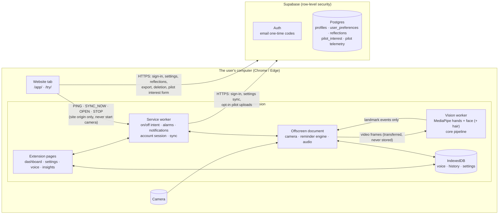

# Architecture

TrichFree has three parts that share one TypeScript code base:

1. **The browser extension** (Chrome and Edge, Manifest V3). It does the actual work: it watches the camera on the
   device, notices possible hand-to-hair movements and gives the reminder the user chose.
2. **The website** (static). It has a landing page, a privacy policy, `/try/` (the real detector running in the
   page, with nothing to install) and `/app/` (the account page: settings, reflections, export, deletion).
3. **The backend** (Supabase: Postgres, Auth). It holds accounts, synced settings, reflections, the pilot interest
   list and opt-in pilot research data. Nothing in the backend is needed for the extension to work. Without an
   account, everything stays on the device ("guest mode").

## Why this stack

- **TypeScript, React, Vite and CRXJS**, kept from the prototype. They worked, the team knows them, and one code
  base now serves both the extension and the website. The detection core, the sync engine and the design system
  are shared rather than duplicated.
- **MediaPipe in the browser**, kept from the prototype. It runs locally, needs no video upload, and is mature and
  maintained.
- **Supabase for accounts and data.** Supabase was already the prototype's pilot backend. It provides:
  - Postgres with row-level security, so access rules live next to the data and are tested;
  - email sign-in with one-time codes, so there are no passwords to store or recover;
  - versioned SQL migrations;
  - a local Docker stack, which lets every test run against the real thing.

  There is no custom API server to secure, patch or scale.
- **A static website.** Netlify or Cloudflare Pages provide HTTPS, security headers from `_headers`, instant
  rollback and generous free tiers. There is no server-side code.
- **What we did not add:** no microservices, no realtime channel, no third-party analytics and no object storage.
  Each would add cost, risk or privacy exposure without a current need.

## Repository layout

| Path | What it is |
|---|---|
| `src/core/` | Pure TypeScript, no DOM or `chrome.*`: face frame, zones, features, scorer, temporal filter, pipeline, reminder engine, randomisation, evaluation harness. Runs in Node for tests and replay. |
| `src/sync/` | Synced preference schema and validation (`prefs.ts`), three-way merge (`merge.ts`), sync orchestration (`engine.ts`) and the Supabase adapters (`remote.ts`). Shared by the extension and the website. |
| `src/background/` | Service worker (`sw.ts`) and account/session handling (`account.ts`). |
| `src/offscreen/` | Offscreen document: camera, vision worker client, reminder engine, audio player, health and presence checks. |
| `src/workers/` | The vision worker (MediaPipe) and its message protocol. |
| `src/app/`, `src/popup/`, `src/ui/` | Extension pages, the toolbar popup, and the shared design system (tokens, controls, preferences form). |
| `src/shared/` | IndexedDB schema (Dexie) and migrations, typed messages, telemetry mapping and upload queue, backup, safety contacts, copy. |
| `web/` | The website (Vite multi-page build, `vite.web.config.ts`). |
| `supabase/` | Local stack config, SQL migrations, the sign-in email template. |
| `test/`, `e2e/` | Unit tests, database integration tests, browser tests (see TESTING.md). |
| `scripts/` | Build helpers, fixtures, evaluation, soak, model download (pinned and checksummed), pilot code generator. |

## The extension

**Service worker** (`src/background/sw.ts`) owns the user's intent (monitoring on or off) in `chrome.storage`. A
Manifest V3 worker can be stopped at any time, so it keeps no state in memory that matters. It creates and closes the
offscreen document, runs alarms, shows notifications, and handles keyboard commands and messages. It holds the
account session (below). On browser start it never restarts the camera silently: if monitoring was on, it records
an "interrupted" state and the dashboard and popup offer to start again.

**Offscreen document** (`src/offscreen/`) exists only while monitoring is on (reasons `USER_MEDIA` and
`AUDIO_PLAYBACK`). It opens the camera, transfers the video track's frames to the vision worker, runs the reminder
engine (`src/core/engine.ts`), plays the chime and voice clips, logs episodes to IndexedDB, and reports health.
Health means "watching", "watching (slowly)", or a real problem such as no frames for 15 s.

**Vision worker** (`src/workers/vision.worker.ts`) runs MediaPipe Hand Landmarker and Face Landmarker, plus an
optional hair segmenter while a hand is visible. They use the GPU, or the CPU when WebGL is only software-emulated
(much faster there). The worker passes landmarks through `src/core/pipeline.ts`: face frame, features, scorer, then
the temporal filter (smoothing, dwell, gaps, missed-detection holds and hysteresis). It sends only events back.
Frames are closed as soon as they are processed and are never stored. See docs/DETECTION_REPORT.md for how the
detector behaves.

**Reminder engine** (`src/core/engine.ts`): one episode per reach. Each episode gets a reminder: voice, chime, a
visual cue, or nothing, if "off" or during the pilot's silent baseline. There is at most one optional follow-up, then
a quiet time (5 s–10 min, default 30 s) before a new episode can start, so it never loops. Feedback ("Not a pull",
"I just pulled") comes from the dashboard, the popup, notification buttons and shortcuts.

**Voice recordings are local-first.** They are recorded, trimmed and normalised on the device and stored in
IndexedDB, and they are never uploaded, including for sync. On a new computer the user records their voice lines
again, which takes about a minute. Until then the chime plays instead and the app says why. The Voice page,
onboarding and the dashboard say so. Moving recordings is possible through a local backup file the user exports
and imports.

## Accounts and sessions

- **Sign-in:** email plus a 6-digit one-time code (Supabase Auth, OTP). There are no passwords and no links in
  emails, so no sign-in token ever travels in a URL. A code expires after 10 minutes, and asking for a new code
  invalidates the old one. The first sign-in creates the account. A database trigger creates the profile, and the
  privacy-policy version accepted is recorded with a server-side timestamp.
- **Extension:** the service worker owns the Supabase client. It stores the session in `chrome.storage.local`
  (`tf-auth`) and refreshes tokens on demand rather than on a timer, which a sleeping worker could miss. It
  serialises all account operations so two refreshes cannot race. Pages never see a token: they read a token-free
  `accountState` and send `ACCOUNT_*` / `SYNC_*` messages.
- **Website:** supabase-js with its default `localStorage` session, protected by the site's strict CSP
  (SECURITY.md).
- **Guest mode** is the default. No account is ever required, and onboarding does not ask for one. The account chip
  says "Guest · Save across devices" until the user signs in. Signing out keeps the device's data and
  stops syncing. "Delete all data on this computer" and "Delete account" are separate, clearly labelled actions.

## Data map

| Data | Stored | Synced across devices | Leaves the device |
|---|---|---|---|
| Camera frames | Never | No | Never |
| Voice recordings | IndexedDB (`clips`) | No: record again on each computer, or move with a backup file | Only inside a backup file the user exports |
| Reminder, detection, companion and accessibility settings (`SyncedPrefs`) | IndexedDB (`settings`) | **Yes**, with an account | To Supabase `user_preferences` (RLS: owner only) |
| Calibration (tune-up), personal model, feature samples | IndexedDB | No: specific to that camera | No |
| Episodes, events, sessions (history) | IndexedDB | No | Only opt-in pilot participants: pseudonymous rows keyed by participant code |
| Reflections (short notes in the web app) | Supabase `reflections` | Account-wide | Yes (owner only) |
| Email, display name, policy version | Supabase `profiles` / `auth.users` | Account-wide | Yes (owner only) |
| Pilot interest form | Supabase `pilot_interest` | — | Yes (team only; no client can read it) |

Synced settings: `intervention`, `sensitivity`, `zones`, `cooldownSeconds`, `followUp`, `chimeVolume`,
`visualNotifications`, `microPrompt`, `supportiveText`, `companionEnabled`, `companionTone`, `dailyGoalMinutes`,
`reminderTime`, `reduceMotion`. Settings that only make sense for one computer stay local: camera calibration,
lighter detection (frame rate), the debug page, pilot enrolment.

## Cross-device sync

### When it syncs

**Extension:**
- 1.5 s after a settings change;
- whenever an extension page is opened or comes back into view, if the last sync is over 15 seconds old;
- every 15 minutes while signed in;
- at browser start;
- after sign-in;
- on "Sync now";
- when the website asks it to (`SYNC_NOW` through the bridge, sent right after the website saves).

**Website:** on load, after each change, and whenever the tab regains focus.

### How a sync works (`src/sync/engine.ts`)

Each device keeps four things locally: its current values, the server copy and version from its last successful
sync (the *base*), a *dirty* map recording which fields the user changed on this device since then (with a
timestamp), and the account it is linked to.

1. Read the server row.
2. **No row yet** (the account never saved settings): create it from this device's settings. If another device
   created it at the same moment, the insert fails on the primary key, and this device merges with theirs.
3. **Device not yet linked to this account** (first sign-in on this device, and the account already has settings):
   the account's settings win. The device loads them and says so ("Loaded your saved settings"). Guest settings are
   not merged into an existing account, because silently mixing two people's or two contexts' settings would be
   surprising.
4. **Linked:** a field-level three-way merge (`src/sync/merge.ts`) between the base, this device and the server
   (rules below).
5. If this device has changes to send, it updates only those fields, and only if the server row is still at the
   version the merge used: `update … where version = base`. A trigger bumps the version on every write. If someone
   else wrote in between, nothing is changed; the device fetches again and re-merges (up to 4 attempts).
6. Commit locally in one IndexedDB transaction. A field the user changed again *while* the sync was running keeps
   its newer local value and stays dirty, so it goes out with the next sync instead of being overwritten.

### Conflict resolution

| Situation | Result |
|---|---|
| A field changed only on this device | This device's value is sent. |
| A field changed only on another device | This device takes the server value ("Updated from your other device"). |
| Different fields changed on two devices | Both changes are kept (field-level merge). |
| **The same field** changed on two devices since they last synced | **The value that reached the server first is kept.** The other device takes it and shows "Changed on two devices at once", naming the settings where the other device's choice was kept, so nothing changes silently. |
| A local value differs but was never changed by the user (for example, restored from a backup) | The server value is authoritative. |

Why "first to reach the server wins" rather than "latest clock time": device clocks cannot be trusted, while the
server's version order is exact. Each conflict is reported to the user rather than resolved invisibly. The cases are
covered by unit tests (`test/sync.test.ts`), database integration tests (`test/integration/sync.int.test.ts`) and a
two-browser test (`e2e/cross-device.spec.ts`).

### Offline

Changes are saved locally first and marked dirty. With no network the sync fails as `offline`, nothing is lost, the
account chip shows "Offline · will sync", and the next sync sends the changes. The
extension works fully offline; only account features need the network. An expired or revoked session shows "Sign in
again to keep syncing" and local data is kept.

### Validation and schema versions

- `src/sync/prefs.ts` validates every field, both when a user edits it and when values arrive from the server or a
  backup. The database has matching `CHECK` constraints, and integration tests check that the app and the database
  accept and reject exactly the same values.
- Rows carry `schema_version` (currently 1). Clients write only the fields they changed (patches, never whole rows),
  so an older app version cannot reset a field that a newer version added. New fields get database defaults.
- Local data: Dexie schema versions with upgrade functions. Version 2 added the sync metadata table and migrated the
  old settings format (`outputMode`, `notifications`, `mochiTone`) to the new intervention model; a unit test covers
  it. Backups carry a format version and are cleaned and validated on import.
- Database: timestamped SQL migrations in `supabase/migrations/`, applied with `supabase db push` (DEPLOYMENT.md).

### Export and deletion

- **Export** (extension Settings or the web account page): `export_my_data()` returns the profile, preferences and
  reflections as JSON. A separate local backup (`.zip`) holds what is only on the device (voice recordings,
  history).
- **Account deletion:** `delete_my_account()` deletes the auth user, and the database cascades to profile,
  preferences and reflections. Afterwards the extension signs out and keeps its local data. "Delete all data on this
  computer" removes that. Copies in the provider's encrypted backups expire within the plan's retention window. The
  privacy policy says this.
- Pilot telemetry is keyed by participant code, not by account. It is deleted on request by the research team.

## Website ↔ extension bridge

The website finds the extension with `chrome.runtime.sendMessage(extensionId, …)`. This works only in Chrome or Edge,
only for the extension IDs the site was built with, and only from origins listed in the extension's
`externally_connectable`. The extension accepts four requests:

- `PING`: version, monitoring status, signed in or not;
- `SYNC_NOW`;
- `OPEN`: open the dashboard;
- `STOP`: stop monitoring.

It rejects everything else. It never lets a web page start the camera: starting always needs the user's own click
inside the extension, where Chrome shows its camera indicator. The pure origin check (`src/shared/bridge.ts`) is unit
tested; the whole path is tested in one browser in `e2e/website.spec.ts`.

## Pilot research mode (optional)

A participant enters a code from the research team (`TF-XXXX-XXXX`, see SECURITY.md) and agrees to the pilot notice.
The schedule is:

- days 1–3 are a silent baseline;
- days 4–14 randomise each episode to chime or own-voice, in permuted blocks seeded by the code;
- after day 14 the user's own choice applies.

Rows (timestamps, outcomes, frame rate; never video, images or audio) go into a local upload queue and are sent
insert-only to Supabase. The server accepts them only for issued codes, and nobody can read them back from a client.
Without a backend the log stays local and can be exported as CSV.

## Design decisions worth knowing

- **Local-first.** Everything works without an account or a network connection. Accounts only add settings sync,
  reflections and export.
- **Field-level sync with server-ordered conflicts**, not "last write wins by clock". This is safer and explainable
  in one sentence.
- **No realtime channel.** Settings change rarely, and syncing on change, focus and open, plus every 15 minutes, is
  enough. It also keeps the backend to Postgres and Auth only (Realtime, Storage and Edge Functions are disabled).
- **One code base, two hosts.** `src/core`, `src/sync` and `src/ui` are imported by both the extension and the
  website, so the account page and the extension save settings through the same merge code.
- Older choices and their reasons are in DECISIONS.md.
